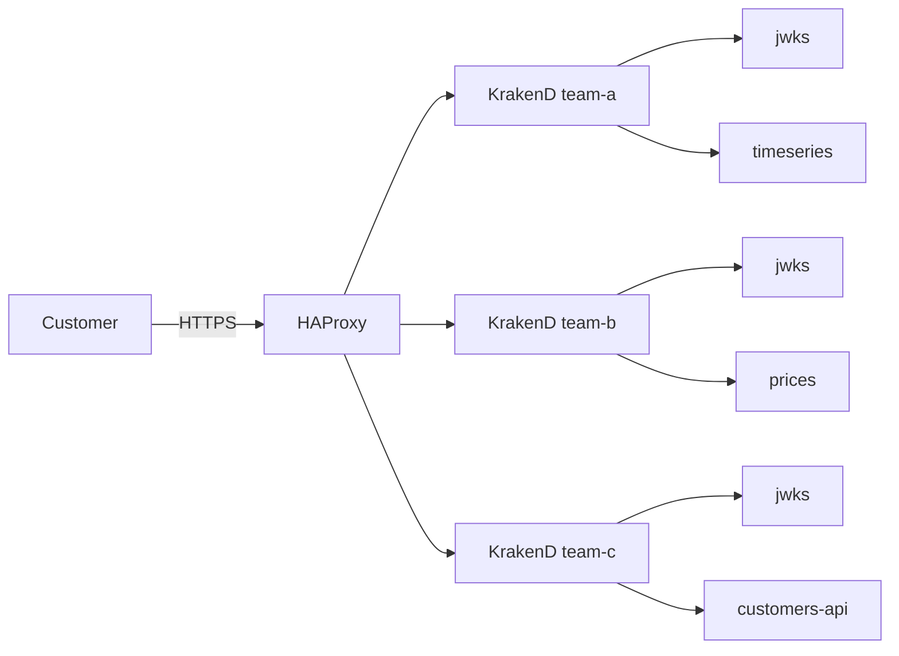
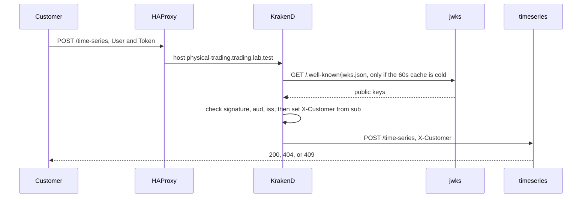
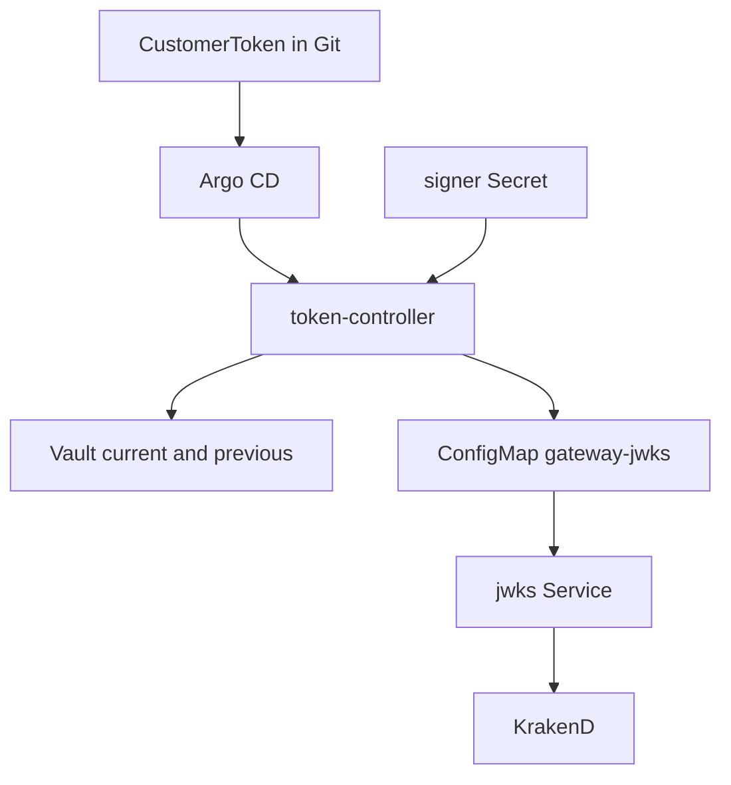

# Team API gateways

How the three team APIs are exposed in this lab. A customer calls a hostname. HAProxy sends that host to one KrakenD. KrakenD checks the token against that team's public keys, then calls the business API. The business API does not serve keys.

A token belongs to one API id. It does not belong to a domain or a team. `trading.lab.test` and `customer.lab.test` are hostname suffixes. They are not a shared process.

The operator summary stays in `docs/k3s-platform-overview.md`. This file is the decision record. The path after a fact is where that behavior is written.

| What | Where |
| --- | --- |
| Team A gateway, signer, JWKS, routes, tokens | `platform/gateways/team-a.yaml` |
| Team B, same shape | `platform/gateways/team-b.yaml` |
| Team C, Service name `customers-api` | `platform/gateways/team-c.yaml` |
| `CustomerToken` schema | `platform/gateways/crd.yaml` |
| Argo CD Application `gateways` | `gitops/apps/gateways.yaml` |
| Signing, Vault write, JWKS ConfigMap | `services/controller/controller.py` |
| JWKS reader, one image for every team | `services/jwks/app.py` |
| Time-series ownership | `services/team-a/timeseries/app.py` |
| Price ownership | `services/team-b/prices/app.py` |
| Customer-record ownership | `services/team-c/customers/app.py` |
| Image builds | `.gitea/workflows/` |
| API and JWKS reachable only from the team gateway | `platform/network/policies.yaml` |
| CA `lab-platform-ca` | `platform/issuers/issuers.yaml` |

## What a call goes through



Each `jwks` box is a Service in that team's namespace. The three boxes run one image, `harbor.lab.test/lab/jwks:current`. They do not share a pod or a key.



A missing token stops at KrakenD. The business API is not called.

Issuance does not go through the customer path. The controller is the only writer.



`status` on the `CustomerToken` gets `jti`, `kid`, and expiry. The token string stops at Vault. Token rotation does not change the ConfigMap, so both token strings verify without a KrakenD restart.

## Public keys

Each team has one signing certificate and one JWKS document. The controller reads the signer Secret and writes ConfigMap `gateway-jwks` in that namespace (`publish_jwks` in `services/controller/controller.py`). The document is not in Git. The `jwks` Deployment mounts it at `/etc/jwks` as a directory, `optional: true`, so the pod can start before the first write. `services/jwks/app.py` opens that file on every `GET /.well-known/jwks.json` and returns `{"keys":[]}` when the file is missing. Kubelet refreshes the directory when the ConfigMap changes, so a new key is visible on the next request without restarting the JWKS pod.

The public URL is the gateway host, with no token:

`https://<gateway-host>/.well-known/jwks.json`

That route has no `auth/validator`. Its backend is `http://jwks:8080`. KrakenD's own check uses the same URL as `jwk_url`, with `cache: true` and `cache_duration: 60`, and `disable_jwk_security: true` because the hop is cluster HTTP. A team pod cannot open TCP 443 to the world, and it cannot call back through the public Ingress.

`CiliumNetworkPolicy/jwks-from-gateway` selects pods labeled `app.kubernetes.io/component: jwks` and allows ingress only from `component: gateway`. HAProxy cannot reach the JWKS pod. The same shape, `api-from-gateway`, covers the business API. A new business API does not mount `gateway-jwks` and does not grow a key route. It adds a KrakenD endpoint whose `jwk_url` is the team Service it already has.

Community KrakenD 3.0.5 cannot replace this reader. `jwk_local_path` is loaded once at process start (`os.ReadFile` in `krakend-jose`) and is not read again, so a directory mount of the ConfigMap would not pick up a new key until the gateway process restarts. `backend/static-filesystem` would serve a file that changes, and it is Enterprise. This lab runs `docker.io/library/krakend:3.0.5`.

`kid` is the SHA-256 of the certificate's Subject Public Key Info, base64url, without padding (`kid_of`). If a Secret named `signer-previous` exists, its certificate is appended to the same document. That Secret is not in the lab.

## One KrakenD per team

Each team runs its own KrakenD in its own namespace. Team A cannot edit team B's gateway. One shared process would put one config, one key set, and one outage on every API. A mistake there could make team A's signing key verify a token on team C.

The domain is the hostname suffix. `trading.lab.test` groups the two trading APIs. `customer.lab.test` is the customer API. `*.lab.test` already resolves to the cluster. HAProxy sends the hostname to that team's gateway Service. Each Ingress is path `/` to that Service, so a new route does not need a new Ingress.

Argo CD Application `gateways` syncs `platform/gateways` from `main` (`gitops/apps/gateways.yaml`). The namespaces are on the objects. There is not a separate Git repository per team.

A later API on an existing host, such as `physical-trading/orders`, is another route and another `CustomerToken` on the team-a gateway. It keeps this KrakenD, this signer, and this JWKS Service. It does not share tokens with time series. That second API is not built.

## Hosts and names

| Domain | Team | Host | API id | Path |
| --- | --- | --- | --- | --- |
| trading | team-a | `physical-trading.trading.lab.test` | `physical-trading/time-series` | `/time-series` |
| trading | team-b | `energy-prices.trading.lab.test` | `energy-prices` | `/prices` |
| customer | team-c | `customers.customer.lab.test` | `customers` | `/customers` |

The API id is `spec.api` on the `CustomerToken` and the `aud` claim. The slash lets one host expose more than one API later. The CRD types `spec.api` as a string and does not forbid a slash. A Kubernetes name cannot contain a slash, so the sample object is `acme-physical-trading-time-series` while `spec.api` is `physical-trading/time-series`. `sign_token` sets `aud` from `spec.api`. `vault_path` turns the slash into another Vault segment, so policy `+/+/+` matches this API and `+/+` matches `energy-prices` and `customers`.

The same customer on both trading APIs has two objects and two tokens. Globex has the same pair, plus the two customer-API tokens in team-c.

Team C's Service is `customers-api` so it is not the same name as the Ingress. KrakenD calls `http://customers-api:8080`, `http://timeseries:8080`, and `http://prices:8080`. The key Service in every namespace is `http://jwks:8080`.

## User, Token, and X-Customer

Callers send `User` (the customer id) and `Token` (the raw JWT, not `Bearer`). KrakenD reads it with `auth_header_name: Token`. The block is ConfigMap `physical-trading-gateway`, key `krakend.json`, in `platform/gateways/team-a.yaml`. Team B and team C repeat it with their own audience, issuer, and business host. The `jwk_url` is `http://jwks:8080/.well-known/jwks.json` in all three.

| Claim | Value |
| --- | --- |
| `sub` | `spec.customer` |
| `aud` | `spec.api` |
| `iss` | the gateway's public `https` host |
| `exp` | issuance plus `spec.ttl` |
| `jti` | a new UUID for that issuance |
| `kid` | in the JWT header, naming the public key |

`propagate_claims` is `[["sub", "X-Customer"]]`. The gateway writes `sub` into `X-Customer` and replaces a client-supplied value. The CEL check then requires one `User`, one `X-Customer`, and those two equal. `input_headers` lists both, which is what makes them visible to CEL and to the backend. The service reads `X-Customer` and ignores a customer id in the JSON body. On physical trading, a POST with `User: acme`, a valid acme token, and `X-Customer: globex` was stored with owner `acme`.

A missing `Token` is HTTP 401 from KrakenD. A `User` that does not match `sub` fails CEL. KrakenD answers HTTP 500 with body `Error #01: request aborted by evaluator #0`. The service is not called in either case. A time-series token sent to `https://energy-prices.trading.lab.test` is HTTP 401. The gateways do not share a JWKS, and the audiences differ.

`output_encoding` and the backend encoding are `no-op`, so a 409 or 404 from the service is returned as the service sent it. `read_body` in the three business services accepts `Transfer-Encoding: chunked`, because KrakenD forwards a POST body that way. `USAGE_DISABLE=1` on the gateway stops KrakenD from calling its usage endpoint, which the world-443 deny would block.

## Signing certificates

The TLS certificate and the signing certificate are different objects. The TLS secret (`physical-trading-tls`, and the same pattern on the other hosts) is issued for the hostname and presented to every client. The signing secret is `physical-trading-signer`, `energy-prices-signer`, or `customers-signer`: RSA 2048, usage `digital signature`, duration `8760h`, `renewBefore: 720h`, issuer `ClusterIssuer/platform-ca`.

Reusing the TLS key would tie token validity to HTTPS renewal, and anyone who can read the TLS secret could mint tokens. Teams share the CA. They do not share a signing key.

The Role `token-controller` may `get` that Secret and `signer-previous`. The delivery team and the customer never see the private key. Later, `issuerRef` can point at an organisation issuer. The token shape stays the same.

Customers do not hold a signing key. They hold the token string. They replace that string on the token schedule: every 30 days in the agreed plan (`ttl: 720h`, `overlap: 168h`), with both strings accepted for the last week. The objects in Git use `ttl: 3m` and `overlap: 90s` so the window can be seen in one run. `overlap` must be shorter than `ttl`, or `reconcile_token` leaves the token as it is.

The signing certificate is a different clock. It lasts a year, and cert-manager starts renewal 30 days before expiry. This lab's cert-manager is 1.21 and the Certificate does not set `privateKey.rotationPolicy`. Since cert-manager 1.18 the default is `Always`, so that renewal mints a new private key. Tokens already issued keep verifying only while the old public key is still in the JWKS document. The controller publishes that old key when it is in `signer-previous`. Nothing copies the current certificate there before cert-manager replaces the signer Secret, so an unattended renewal would drop the old key. That handoff is not built. A key change still does not ask the customer to rotate a key of their own. The team sends a new token string.

On 26 November 2026 the physical-trading acme token was rotated without restarting KrakenD. The previous token expired at 18:47:49 Europe/Tallinn. The replacement expired at 18:49:21 Europe/Tallinn. During the overlap, POST `/time-series` returned 200 for both strings. After 18:47:49 the previous string returned 401 and the current string returned 200.

## Where the token string lives

The platform issues the token. The customer stores the string and sends it back.

`secret/teams/<team>/tokens/<api>/<customer>`

The slash in `physical-trading/time-series` is a path separator, so the acme time-series token is `secret/teams/team-a/tokens/physical-trading/time-series/acme`. The object has `current` and `previous`. The issuer policies in `platform/vault/manifests/auth-config.yaml` allow create, read, and update on those paths only. A team policy cannot read another team's path. That was checked with a team-b userpass token and a team-a Kubernetes login.

The string is not in Git, not in `CustomerToken` status, and not managed by Argo CD. Status stores `jti`, `kid`, `issuedAt`, and `expiresAt`. The controller logs in with the projected ServiceAccount token, role `team-a-issuer` (and the matching roles in the other namespaces).

A delivery team was supposed to copy the string from the Vault UI, without kubectl, and send it to the customer. A human Vault login for that team is still missing. The Vault UI is enabled, and userpass users `team-a`, `team-b`, and `team-c` exist, but those passwords were not handed to a delivery team. There is also no Argo CD or Grafana account for them. The root token stays with the operator.

## Business rules

KrakenD decides whether the token is valid. The service then decides whether this caller may change this data. The caller is `X-Customer`. A missing header is 401 from the service. Data is in memory and disappears when the pod restarts.

On physical trading, a series type has one owner. The first caller to POST a type claims it. Another caller POSTing that type gets 409. A GET of someone else's type is 404. The owner's GET is 200. The body is `{type, instrument, ts, value}`.

Team B and team C use the same caller header and the same 409 / 404 split. Prices are keyed by `(market, delivery)`. Customer records are keyed by `name`. The first caller to write a key owns it. These checks were run against the Actions-built images: an acme time-series write returned 200, a globex write of that type returned 409, a globex GET returned 404, and an acme price write returned 200.

## Build and deploy

Gitea Actions builds the images on `main`. The runner is the host container `gitea/act_runner:0.2.12`, label `ubuntu-latest:docker://docker:27-cli` (`platform/gitea/act-runner.config.yaml`). It uses the host Docker socket. The job container has `sh`, so the workflows set `shell: sh`, and it adds the platform CA before talking to Harbor.

| Image | Harbor name | Workflow |
| --- | --- | --- |
| JWKS | `harbor.lab.test/lab/jwks:current` | `.gitea/workflows/jwks.yaml` |
| Time series | `harbor.lab.test/team-a/timeseries:current` | `.gitea/workflows/team-a.yaml` |
| Prices | `harbor.lab.test/team-b/prices:current` | `.gitea/workflows/team-b.yaml` |
| Customers | `harbor.lab.test/team-c/customers:current` | `.gitea/workflows/team-c.yaml` |
| Controller | `harbor.lab.test/lab/token-controller:current` | `.gitea/workflows/controller.yaml` |

One JWKS image is deployed in all three namespaces. The controller image is in the same Harbor project. Projects `team-a`, `team-b`, and `team-c` are private.

Dockerfiles start `FROM harbor.lab.test/dockerhub/library/python:3.12-slim` because a pod cannot open world TCP 443. The final stage is uid 65532. KrakenD is `docker.io/library/krakend:3.0.5`. containerd rewrites `docker.io` to the Harbor `dockerhub` project. The gateway runs as uid 1000 because that image's default user is root. The KrakenD document's `version` is 4. Version 3 is rejected by this release.

The gateway, the JWKS service, the business API, and the controller set `nodeSelector` `kubernetes.io/hostname: k3s-agent`.

## Add a route

This sample adds `GET /time-series/{type}/latest` on the physical-trading API. It returns the last stored point when `X-Customer` owns that type, and 404 otherwise. The customer keeps the token they already have.

```http
GET /time-series/intraday-power/latest HTTP/1.1
Host: physical-trading.trading.lab.test
User: acme
Token: <the current JWT for physical-trading/time-series>
```

1. Ingress `physical-trading` already sends every path to Service `physical-trading-gateway`.
2. KrakenD checks the JWT against `http://jwks:8080/.well-known/jwks.json`, requires `aud` `physical-trading/time-series`, writes `sub` into `X-Customer`, and requires `User` to equal that value.
3. It forwards to `http://timeseries:8080/time-series/intraday-power/latest`. `api-from-gateway` already allows that.
4. The handler reads `X-Customer` and returns the last point or 404.

Two files change. The signer, the JWKS Service, the Vault path, the Ingress, and the network policy stay.

In `do_GET`, match `/latest` before the existing `/time-series/` branch. The existing branch treats the whole remainder as the type name.

```python
if path.startswith("/time-series/") and path.endswith("/latest"):
    caller = self.caller()
    if not caller:
        self.send_json(401, {"error": "missing caller"})
        return
    kind = path[len("/time-series/"):-len("/latest")]
    item = SERIES.get(kind)
    if item is None or item["owner"] != caller or not item["points"]:
        self.send_json(404, {"error": "not found"})
        return
    self.send_json(200, {"type": kind, "owner": caller, "point": item["points"][-1]})
    return
```

Add this object to the `endpoints` array. It is the existing GET block with the path extended. `audience` stays `physical-trading/time-series`, or the customer's current token is rejected.

```json
{
  "endpoint": "/time-series/{type}/latest",
  "method": "GET",
  "input_headers": ["User", "X-Customer"],
  "output_encoding": "no-op",
  "extra_config": {
    "auth/validator": {
      "alg": "RS256",
      "auth_header_name": "Token",
      "jwk_url": "http://jwks:8080/.well-known/jwks.json",
      "disable_jwk_security": true,
      "cache": true,
      "cache_duration": 60,
      "audience": ["physical-trading/time-series"],
      "issuer": "https://physical-trading.trading.lab.test",
      "propagate_claims": [["sub", "X-Customer"]],
      "failed_jwk_key_cooldown": "10s"
    },
    "validation/cel": [
      {
        "check_expr": "size(req_headers['User']) == 1 && size(req_headers['X-Customer']) == 1 && req_headers['User'][0] == req_headers['X-Customer'][0]"
      }
    ]
  },
  "backend": [
    {
      "url_pattern": "/time-series/{type}/latest",
      "method": "GET",
      "host": ["http://timeseries:8080"],
      "encoding": "no-op"
    }
  ]
}
```

`endpoint` and `url_pattern` both contain `{type}`. KrakenD substitutes that parameter into the backend URL. The gateway mounts `krakend.json` with `subPath`, so the gateway pod has to be recreated after the ConfigMap changes.

Pushing `services/team-a/**` builds `harbor.lab.test/team-a/timeseries:current`. The tag string does not change, so delete the `timeseries` pod to pull the new digest. Pushing `platform/gateways/team-a.yaml` is what Argo CD applies. Delete the `physical-trading-gateway` pod so it remounts `krakend.json`. The JWKS image is not rebuilt for this route.

A different API on the same host, such as `physical-trading/orders`, needs a new `CustomerToken` with `spec.api: physical-trading/orders` and a route whose `audience` is that string. The same signer, JWKS Service, Ingress, and KrakenD stay. A time-series token is then rejected on `/orders` because `aud` does not match. Do not publish the new route as its own Ingress. The network policy would still block HAProxy, and the route would skip the token check.

## What was deliberately not done

- No shared KrakenD, and no cluster-wide JWKS. Keys stay in the team namespace.
- Business APIs do not serve JWKS.
- TLS certificates are not signing keys. There is no organisation issuer yet.
- Signing-key rotation was not run. `signer-previous` is unused, and nothing copies the current certificate there before cert-manager renews it.
- The lab tokens are `3m` / `90s`, not the agreed `720h` / `168h`.
- A human Vault login that a delivery team holds is not done.
- No second API was added to an existing host. The services do not persist data across a restart.
- KrakenD Enterprise file serving is not used. This lab runs Community 3.0.5.
