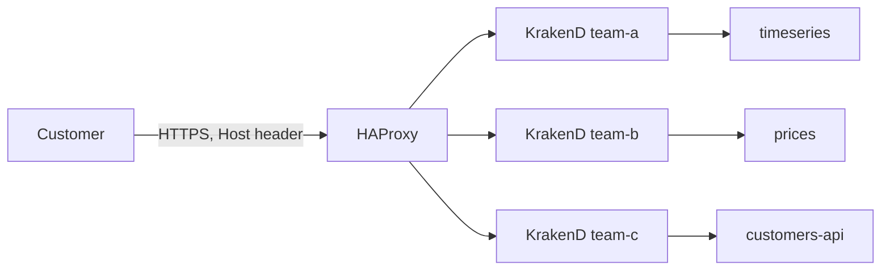
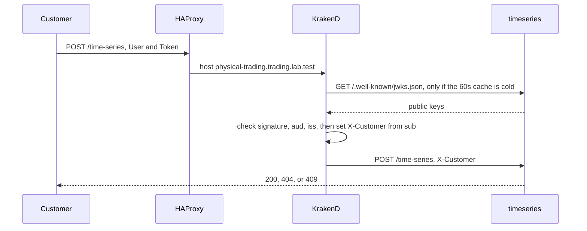
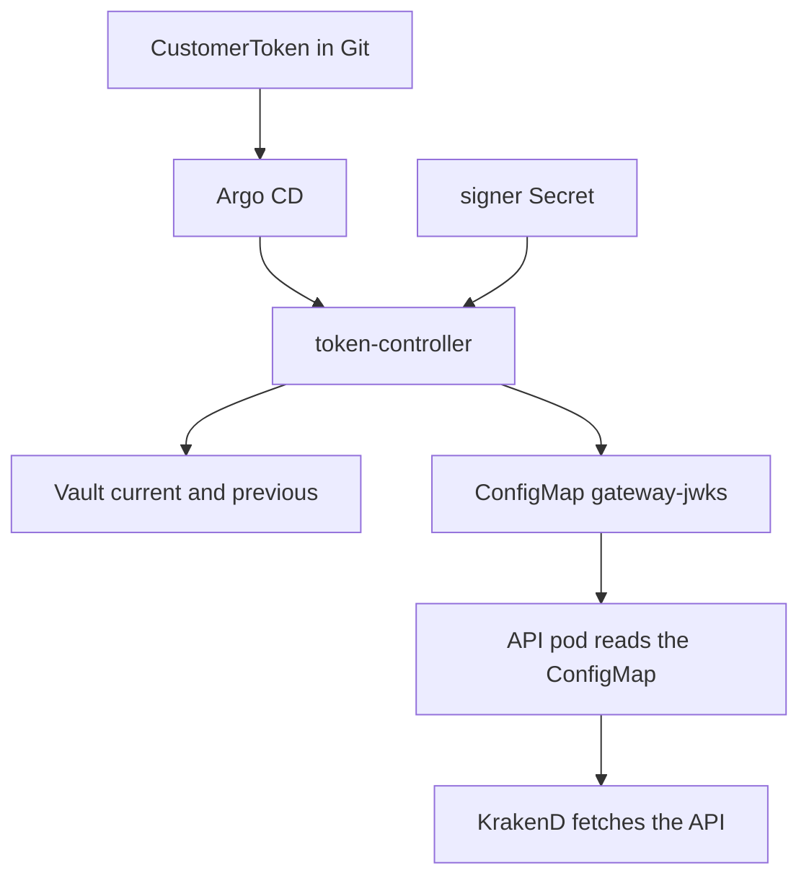

# Team API gateways

Decision record for the three team APIs running in this lab. It follows the manifests in `platform/gateways/`, the token controller, the service code, the Gitea workflows, and the review plan those were built from. The short operator summary stays in `docs/k3s-platform-overview.md`.

A token belongs to one exposed API. It does not belong to a domain, and it does not belong to a team. Trading and customer are domain groups. They show up as the hostname suffix. They are not a shared process.

This file is the whole argument. Each section says what was decided and what the running code does. The path after a fact is where that behavior is written, so opening the file is optional.

| What | Where |
| --- | --- |
| Team A gateway, signer, routes, tokens | `platform/gateways/team-a.yaml` |
| Team B, same shape | `platform/gateways/team-b.yaml` |
| Team C, Service name `customers-api` | `platform/gateways/team-c.yaml` |
| `CustomerToken` schema | `platform/gateways/crd.yaml` |
| Argo CD Application `gateways` | `gitops/apps/gateways.yaml` |
| Signing, Vault write, JWKS | `services/controller/controller.py` |
| Time-series ownership | `services/team-a/timeseries/app.py` |
| Price ownership | `services/team-b/prices/app.py` |
| Customer-record ownership | `services/team-c/customers/app.py` |
| Image builds | `.gitea/workflows/team-a.yaml` and the team-b, team-c, and controller workflows |
| Host runner | `platform/gitea/act-runner.config.yaml` |
| API reachable only from its gateway | `platform/network/policies.yaml`, policy `api-from-gateway` |
| World 443 denied for pods | `platform/network/policies.yaml`, policy `pods-no-world-https` |
| Vault policies | `platform/vault/manifests/auth-config.yaml` |
| userpass users created at unseal | `platform/vault/values.yaml` |
| CA `lab-platform-ca` | `platform/issuers/issuers.yaml` |
| `docker.io` rewritten to Harbor | `ansible/roles/registry_proxy/files/registries.yaml` |

## Architecture

Three hostnames, three KrakenD processes, three private APIs. HAProxy is the only thing a customer can reach. The Python service has no Ingress.



A call that is allowed looks like this. The sample is physical trading. The other two hosts are the same shape with their own audience.



A missing token stops at KrakenD. The service is not called. A second caller who already passed the gateway can still get 409 or 404 from the service.

Issuance does not go through the customer path. The controller is the only writer.



`status` on the `CustomerToken` gets `jti`, `kid`, and expiry. The token string stops at Vault. During a signing-key change the controller would add the previous certificate to the same ConfigMap. That change has not been run. Token rotation does not change the ConfigMap, which is why both tokens work without a KrakenD restart.

## Who serves the public JWKS

The public document has to exist. A customer, or anyone they ask to verify a token, fetches `https://<gateway-host>/.well-known/jwks.json` with no token. That URL is on the gateway host. It is not an argument for giving the Python service an Ingress.

What the backend does today is narrower. `serve_jwks` in each `app.py` reads `/etc/jwks/jwks.json`, which is the ConfigMap the controller wrote. The gateway route for that path has no `auth/validator` and proxies to the Service. KrakenD's own check uses `jwk_url` `http://timeseries:8080/.well-known/jwks.json` (and the matching URL in the other namespaces), with `disable_jwk_security` because that hop is cluster HTTP. The 60 second cache is what picks up a new key without restarting KrakenD.

KrakenD 3 can validate without that hop. `auth/validator` accepts `jwk_local_path` instead of `jwk_url`. The file must be a JWK Set, `{"keys":[...]}`, and the JWT header `kid` must match a key in it. The cache flags apply to a URL, not to a local file. `newLocalSecretProvider` in `krakend-jose` reads that file once with `os.ReadFile` while the process is starting, and `FileKeyCacher` keeps the parsed keys in a map. Later lookups do not open the file again. A signing-key rotation would need the gateway process to reload. Token rotation would not, because the public key stays the same.

Mounting ConfigMap `gateway-jwks` into the gateway the same way the API mounts it does not change that. The API mount is a directory, not a `subPath`, so kubelet replaces the file when the ConfigMap changes. `serve_jwks` opens that file on every request, which is why a new key shows up without restarting the API. KrakenD would see the same updated file on disk and keep using the map it built at start. The public `/.well-known/jwks.json` route would still need a reader that opens the file per request. Community KrakenD does not have one. The API handler is that reader.

Source: KrakenD JWT validation for the v3 schema this lab runs as config `version` 4, and `jwk.go` in `krakend-jose` (`newLocalSecretProvider`, `NewFileKeyCacher`).

Serving that file to the customer is a different feature. `backend/static-filesystem` and `server/static-filesystem` read a directory and follow later writes. Both are Enterprise, and this lab runs Community `docker.io/library/krakend:3.0.5`. Community can embed a fixed document with the static proxy, but that document lives in `krakend.json`. The gateway mounts that file with `subPath`, so it does not see a later edit until the pod is recreated. The controller would also have to rewrite the gateway config, which it does not do. It writes ConfigMap `gateway-jwks`.

So the split stays:

| Question | Answer |
| --- | --- |
| Must the API have a public Ingress for JWKS? | No. The public URL is the gateway. `api-from-gateway` keeps HAProxy off the API pod. |
| Can the gateway validate from a file it mounts? | Yes, with `jwk_local_path`. A new signing key is not a documented live reload. |
| Can this Community gateway publish a file that changes? | No. The file server that updates with the ConfigMap is Enterprise. |
| What should keep originating the document? | The API, because it already mounts `gateway-jwks` as a directory and kubelet refreshes that directory. The gateway only publishes it. |

Moving validation to `jwk_local_path` and leaving the public route proxied would duplicate the file on two pods and still need the API for the public URL. That is not a simpler system. The running choice is the one that matches Community: the controller writes the keys, the API holds the current file, the gateway is the only public copy and the only caller the network policy allows.

## One KrakenD per team

Each team runs its own KrakenD in its own namespace. Team A cannot edit team B's gateway. A shared process was rejected because one config, one JWKS, and one outage would then cover every API. A mistake in that shared config could make team A's signing key verify a token on team C. Separate processes keep the audience, the signing key, and the failure inside the team that owns the API.

The domain is only the suffix of the hostname. `trading.lab.test` groups the two trading APIs. `customer.lab.test` is the customer API. `*.lab.test` already resolves to the cluster, so these names needed no DNS change. Each team owns the Ingress, the TLS certificate, and the KrakenD config for its host. HAProxy sends the hostname only to that team's gateway Service.

There is one Argo CD Application, `gateways`, which syncs `platform/gateways` from `main` (`gitops/apps/gateways.yaml`). The separation is the namespace and the process, not a separate Git repository per team. The three Ingress objects are in the team manifests. Each one is path `/` to that team's gateway Service, so a new route does not need a new Ingress.

A later API on an existing host, such as `physical-trading/orders`, would be another route and another `CustomerToken` on the team-a gateway. It would not get a new KrakenD, and it would not share tokens with time series. That second API is not built.

## Hosts, API ids, and names

| Domain | Team | Host | API id | Path |
| --- | --- | --- | --- | --- |
| trading | team-a | `physical-trading.trading.lab.test` | `physical-trading/time-series` | `/time-series` |
| trading | team-b | `energy-prices.trading.lab.test` | `energy-prices` | `/prices` |
| customer | team-c | `customers.customer.lab.test` | `customers` | `/customers` |

The API id is `spec.api` on the `CustomerToken` and the `aud` claim of the JWT. The slash form is allowed so one host can expose more than one API later and each API stays a distinct audience. The CRD (`platform/gateways/crd.yaml`) types `spec.api` as a string and does not forbid a slash. `sign_token` in `services/controller/controller.py` sets `aud` from `spec.api` and does not read `spec.domain`.

A Kubernetes object name cannot contain a slash. The sample object is therefore `acme-physical-trading-time-series` in namespace `team-a`, while `spec.api` is `physical-trading/time-series`. That object is the last resource in `platform/gateways/team-a.yaml`. `spec.domain` is `trading` or `customer`. The issuer is the public `https` host, passed to the controller as `ISSUER` on the Deployment in the same file. `vault_path` in the controller turns the slash into another Vault segment, so the policy `+/+/+` in `platform/vault/manifests/auth-config.yaml` matches this API and `+/+` matches `energy-prices` and `customers`.

The same customer who calls both trading APIs has two objects and two tokens: `acme-physical-trading-time-series` in team-a, and `acme-energy-prices` in team-b. Globex has the same pair, plus `acme-customers` and `globex-customers` in team-c.

Team C's Service is named `customers-api` so it is not the same name as the Ingress. KrakenD calls `http://customers-api:8080`. Team A calls `http://timeseries:8080`. Team B calls `http://prices:8080`.

## User, Token, and X-Customer

Callers send two headers. `User` is the customer id. `Token` is the raw JWT, not a `Bearer` token. KrakenD 3.0.5 reads it with `auth_header_name: Token`. The block is the ConfigMap `physical-trading-gateway`, key `krakend.json`, in `platform/gateways/team-a.yaml`. The same block is copied for `POST /time-series` and `GET /time-series/{type}`. Team B and team C repeat it with their own `audience`, `issuer`, and backend host.

The controller signs RS256. The claims are:

| Claim | Value |
| --- | --- |
| `sub` | `spec.customer` |
| `aud` | `spec.api` |
| `iss` | the gateway's public `https` host |
| `iat`, `nbf` | time of issuance |
| `exp` | issuance plus `spec.ttl` |
| `jti` | a new UUID for that issuance |
| `kid` | SHA-256 of the signing certificate's Subject Public Key Info, base64url, in the JWT header |

KrakenD checks the signature against that team's JWKS, then checks `aud` and `iss`. `propagate_claims` is `[["sub", "X-Customer"]]`, so the gateway writes `sub` into `X-Customer` and replaces a client-supplied value. The CEL expression then requires exactly one `User`, exactly one `X-Customer`, and those two values equal. `input_headers` lists both names, which is what makes them visible to CEL and to the backend. The service never reads a customer id from the JSON body. `caller()` in each `app.py` returns `X-Customer` and nothing else.

This is why a caller cannot act as someone else by setting the header. On the physical-trading API, a POST with `User: acme`, a valid acme token, and `X-Customer: globex` was stored with owner `acme`.

A missing `Token` is HTTP 401 from KrakenD, and the Python service is not called. A `User` that does not match `sub` fails the CEL check. KrakenD aborts that request with HTTP 500 and body `Error #01: request aborted by evaluator #0`. That is still a gateway rejection: the service is not called. A token for `physical-trading/time-series` sent to `https://energy-prices.trading.lab.test` is HTTP 401. The gateways do not share a JWKS, and the audiences differ.

`output_encoding` and the backend encoding are `no-op`, so a 409 or 404 from the service is returned as the service sent it. `/.well-known/jwks.json` on the gateway has no `auth/validator`, so an external customer can fetch the public keys. KrakenD itself fetches JWKS from `http://timeseries:8080/.well-known/jwks.json` with `disable_jwk_security: true`, because a team pod cannot open TCP 443 to the world and cannot call back through the public Ingress. The cache is 60 seconds, and `failed_jwk_key_cooldown` is 10 seconds. `read_body` in the three services accepts `Transfer-Encoding: chunked`, because KrakenD forwards a POST body that way and does not set `Content-Length`. `USAGE_DISABLE=1` on the gateway Deployment stops KrakenD from calling its usage endpoint, which the same 443 deny would block.

The Python services have no Ingress of their own. `CiliumNetworkPolicy/api-from-gateway` in `platform/network/policies.yaml` selects pods labeled `app.kubernetes.io/component: api`, allows ingress from `component: gateway`, and denies the ingress namespace and every other pod. The API Deployments carry the `api` label. The gateway Deployments carry the `gateway` label. A `wget` from the team-a sample pod to `timeseries.team-a.svc:8080` timed out.

## Signing certificates

The certificate that terminates HTTPS is not the certificate that signs tokens. The TLS secret (`physical-trading-tls`, and the same pattern for the other two hosts) is issued for the hostname by the Ingress annotation `cert-manager.io/cluster-issuer: platform-ca` and is presented to every client. The signing secret is a different cert-manager `Certificate` at the top of each team manifest: `physical-trading-signer`, `energy-prices-signer`, and `customers-signer`. Each is RSA 2048, usage `digital signature`, duration `8760h`, and `issuerRef` `ClusterIssuer/platform-ca`. That issuer is `platform/issuers/issuers.yaml`. The CA certificate's common name is `lab-platform-ca`.

Reusing the TLS key would tie token validity to HTTPS renewal, and anyone who can read the TLS secret could mint tokens. Sharing one signing key across teams would let a token signed for team A verify on team C. Teams may share the CA. They do not share a signing key.

Later, the same `Certificate` can point `issuerRef` at an organisation issuer. The token shape does not change: `kid` still names the public key in that gateway's JWKS, and the private key still stays in the cert-manager Secret. The Role `token-controller` in the team manifest may `get` only that Secret and a Secret named `signer-previous`. The delivery team and the customer never see the private key.

JWKS is the public half. `publish_jwks` writes ConfigMap `gateway-jwks`, which is not in Git. The API volume mounts it at `/etc/jwks` and is `optional: true`, so the pod can start before the first write. `serve_jwks` returns `{"keys":[]}` when the file is missing. `kid_of` is the SHA-256 of the certificate's Subject Public Key Info, base64url, with the padding removed. If `signer-previous` exists, its certificate is appended to the document. KrakenD caches that document and does not restart when it changes. The gateway publishes the document. The API does not have a public JWKS Ingress. Why that split stays, on Community KrakenD, is in "Who serves the public JWKS" above.

## Token rotation and signing-key rotation

These are different events.

Token rotation is the normal schedule. `reconcile_token` signs a new JWT with the same key. The previous JWT stays valid until its own `exp`. JWKS does not change. The process sleeps `INTERVAL_SECONDS`, default 10. While `now` is earlier than `exp` minus `overlap`, it returns without writing. Inside the overlap it moves the Vault `current` string to `previous`, copies the old `jti`, `kid`, `issuedAt`, and `expiresAt` onto `status.previous`, and signs a new current token. After the old `exp`, the next pass issues a fresh token and stores an empty `previous`. The status patch is a merge patch on the status subresource. The log line is `issued <name> jti=... exp=... previous=true|false` and does not print the token.

Signing-key rotation is rare. A new certificate replaces the signer Secret. New tokens use the new `kid`. The previous public certificate has to remain in JWKS until every token it signed has expired, which is what `signer-previous` is for. That rotation has not been run. The Secret is named in the controller Role so it can be read when it exists. It is not present in the lab.

Customers do not have a signing key, so a key change is not something they perform. They hold the token string the team sent them. Replacing that string is the token schedule above: every 30 days in the agreed `720h` / `168h` plan, with both strings working for the last week. The signing certificate is a different clock. It is valid for `8760h` and cert-manager starts renewal `720h` before expiry, about once a year. This lab's cert-manager is 1.21, and the Certificate does not set `privateKey.rotationPolicy`. Since cert-manager 1.18 the default is `Always`, so that renewal mints a new private key. Tokens already in customers' hands keep verifying only while the old public key is still in JWKS. The controller will publish that old key if it is in `signer-previous`. Nothing copies the current certificate there before cert-manager replaces the signer Secret, so an unattended renewal would drop the old key and the current token strings would fail until the team sends a token signed by the new key. That handoff is not built.

The agreed schedule is `ttl: 720h` and `overlap: 168h`: the replacement is issued one week before expiry, and both tokens work during that week. `parse_duration` accepts a trailing `s`, `m`, or `h`. The objects in Git use `ttl: 3m` and `overlap: 90s` so the window can be seen in one run. The comment on `acme-physical-trading-time-series` in `platform/gateways/team-a.yaml` says that. `overlap` must be shorter than `ttl`, or `reconcile_token` raises and leaves the token as it is.

On 26 November 2026 the physical-trading acme token was rotated without restarting KrakenD. The previous token expired at 18:47:49 Europe/Tallinn. The replacement expired at 18:49:21 Europe/Tallinn. During the overlap, POST `/time-series` returned 200 for both the previous token and the current token. After 18:47:49 the previous token returned 401 and the current token returned 200.

## Where the token string lives

The platform issues the token. The customer stores the string and sends it back. The customer does not create a key and does not upload one.

The string is a kv-v2 secret written by `write_vault`:

`secret/teams/<team>/tokens/<api>/<customer>`

The slash in `physical-trading/time-series` is a path separator, so the acme time-series token is `secret/teams/team-a/tokens/physical-trading/time-series/acme`. The object has two keys, `current` and `previous`. Energy prices and customers have one fewer segment, for example `secret/teams/team-b/tokens/energy-prices/acme`. The issuer policies in `platform/vault/manifests/auth-config.yaml` allow create, read, and update on those token data paths only. The human policies allow read, and list on the metadata. A team policy cannot read another team's path. That was checked with a team-b userpass token and with a team-a Kubernetes login: each was denied on the other team's path and could still read its own.

The string is not in Git, not in `CustomerToken` status, and not managed by Argo CD. `status_meta` stores `jti`, `kid`, `issuedAt`, and `expiresAt`. `previous` stores the same four fields and not the old string. The CRD has no field for the token. Argo CD syncs the spec from `platform/gateways`. The controller writes the Vault object after that. The login is `vault_login`: the projected ServiceAccount token, audience `https://kubernetes.default.svc.cluster.local`, role `team-a-issuer` (and the matching roles in the other namespaces).

A delivery team was supposed to copy the string from the Vault UI, without kubectl, and send it to the customer out of band. The customer does not get a Vault, Argo CD, or Grafana account.

A human Vault login for a delivery team is still missing. The controller logs in with Kubernetes auth, as above. The Vault UI is enabled in `platform/vault/values.yaml`. The postStart hook enables userpass and, when the `vault-ui` Secret is mounted, writes users `team-a`, `team-b`, and `team-c` onto the team read policies. Those passwords stay in that Secret and in `credentials/lab-secrets.env`, which is gitignored. They were not given to a delivery team. There is also no Argo CD or Grafana account for a delivery team, so the team cannot yet confirm expiry in Argo CD or copy the token themselves. The root token stays with the operator.

## Business rules

KrakenD decides whether the token is valid. The service then decides whether this caller may change this data. Gateway acceptance is not enough. The caller is `X-Customer`. If that header is missing, the service returns 401. Data is in memory and disappears when the pod restarts.

On physical trading, a series type has one owner. `SERIES` in `services/team-a/timeseries/app.py` is keyed by type. The first caller to POST a type claims it and may append points. Another caller POSTing that type gets 409 and the stored points stay. A GET of someone else's type is 404, so the existence of the type is not confirmed to them. The owner's GET is 200. Two callers may use the same instrument name under different types, because the key is the type and not the instrument. They cannot share a type.

The body is `{type, instrument, ts, value}`. A customer id in that JSON is ignored. The handler never reads one.

Team B and team C use the same caller header and the same 409 / 404 split. `PRICES` in `services/team-b/prices/app.py` is keyed by `(market, delivery)`. `CUSTOMERS` in `services/team-c/customers/app.py` is keyed by `name`. The first caller to write that key owns it. A later write by the owner replaces the value (prices) or keeps the record (customers). Another caller gets 409 and the record stays. A GET of a key that caller does not own is 404. Team B and team C do not apply the time-series type rule. They only change records that caller created.

These checks were run against the Actions-built images: an acme time-series write returned 200, a globex write of that same type returned 409, a globex GET of it returned 404, and an acme price write returned 200.

## Build and deploy

Gitea Actions builds the images. The workflow files are `.gitea/workflows/team-a.yaml`, `team-b.yaml`, `team-c.yaml`, and `controller.yaml`. The runner is the host container `gitea/act_runner:0.2.12`, label `ubuntu-latest:docker://docker:27-cli`, configured in `platform/gitea/act-runner.config.yaml`. It uses the host Docker socket because the k3s nodes have containerd only. A privileged Docker-in-Docker pod in a team namespace would be denied by Kyverno, so the runner is not a pod in `gitea` or in a team namespace. The job container is `docker:27-cli`, which has `sh` and not `bash`, so the workflows set `shell: sh`. The runner mounts the platform CA into the job and does not mount the Docker socket a second time. The job adds that CA to the Alpine trust store, because the Docker 27 client checks Harbor's certificate itself.

Workflows on `main` build only the tree that changed: `services/team-a`, `services/team-b`, `services/team-c`, or `services/controller`. They clone `main` from `https://gitea.lab.test` with the lab CA and push `:current`. Harbor credentials are Actions secrets, not files in Git.

| Image | Harbor name | Running digest when this record was written |
| --- | --- | --- |
| Time series | `harbor.lab.test/team-a/timeseries:current` | `sha256:05619ce66b1eabb503f565a5f6db4d9c0d04bd72df04d61c3f4b5d5e6dacff52` |
| Prices | `harbor.lab.test/team-b/prices:current` | `sha256:5a3990084ce34980c8546c70a7ad1159f5437d34c0566e0bb059edc9a1f5e140` |
| Customers | `harbor.lab.test/team-c/customers:current` | `sha256:c2fb2db494afbd6c8385f94e98d28b71dc2b0ab69f2504d3a4bedbae88446680` |
| Controller | `harbor.lab.test/lab/token-controller:current` | `sha256:991f06d5fd310c898376cf5e5aaad2ef821033fe4974869f64776da32cc0b2b9` |

Projects `team-a`, `team-b`, and `team-c` are private. Project `lab` is the public proxy project, which is where the controller image was pushed. Those four digests are the images the pods were running, and they are the images the workflows pushed.

Dockerfiles under `services/team-a/timeseries`, `services/team-b/prices`, `services/team-c/customers`, and `services/controller` start `FROM harbor.lab.test/dockerhub/library/python:3.12-slim`. A pod cannot open world TCP 443 (`pods-no-world-https`), so the base image has to come through Harbor. The final stage is non-root, uid 65532. KrakenD is `docker.io/library/krakend:3.0.5` on the gateway Deployment. `ansible/roles/registry_proxy/files/registries.yaml` rewrites `docker.io` to the Harbor `dockerhub` project, so that pull does not go to Docker Hub either. The image's default user is root, and `runAsNonRoot` rejected it, so the gateway `securityContext` sets `runAsUser: 1000`. The KrakenD document's `version` is 4. Version 3 is rejected by this release.

The gateway, the API, and the controller set `nodeSelector` `kubernetes.io/hostname: k3s-agent`. Vault stays on `k3s-server`. The pre-existing sample pod is still on `k3s-server` and is not one of these APIs.

## Expose one new endpoint

This sample adds `GET /time-series/{type}/latest` on the physical-trading API. It returns the last stored point when `X-Customer` owns that type, and 404 otherwise. It is a new route on an API that already exists. It is not a new API, so the customer keeps the token they already have.

The call the customer makes does not change shape:

```http
GET /time-series/intraday-power/latest HTTP/1.1
Host: physical-trading.trading.lab.test
User: acme
Token: <the current JWT for physical-trading/time-series>
```

What happens, in order:

1. The Ingress `physical-trading` already sends every path to Service `physical-trading-gateway`. A new route does not get its own Ingress. HAProxy never sees the Python pod.
2. KrakenD matches the new endpoint. It checks the JWT against the existing JWKS, requires `aud` `physical-trading/time-series`, writes `sub` into `X-Customer`, and requires `User` to equal that value.
3. It forwards to `http://timeseries:8080/time-series/intraday-power/latest`. `api-from-gateway` allows that because the source pod is labeled `component: gateway`. No network change.
4. The handler in the time-series service reads `X-Customer`, looks up the type, and returns the last point or 404. A customer id in a query string is not read.

Two files change. Everything else stays, and that is the point of the layout.

| Change | Leave alone | Why |
| --- | --- | --- |
| `services/team-a/timeseries/app.py` | Signer, JWKS, Vault path | The business rule lives in the service. The token is still for this API id. |
| One object in the `endpoints` array of ConfigMap `physical-trading-gateway` | Ingress, Certificate, CustomerToken, network policy | The public door is already open for this host. The new route must run the same auth or it would be an unauthenticated path on that host. |

### Service

In `do_GET`, match `/latest` before the existing `/time-series/` branch. The existing branch treats the whole remainder as the type name, so `/time-series/intraday-power/latest` would otherwise be looked up as the type `intraday-power/latest` and returned 404.

```python
if path.startswith("/time-series/") and path.endswith("/latest"):
    caller = self.caller()
    if not caller:
        self.send_json(401, {"error": "missing caller"})
        return
    kind = path[len("/time-series/"):-len("/latest")]
    item = SERIES.get(kind)
    if item is None or item["owner"] != caller or not item["points"]:
        self.send_json(404, {"error": "not found"})
        return
    self.send_json(200, {"type": kind, "owner": caller, "point": item["points"][-1]})
    return
```

`caller()` is already `X-Customer`. Reusing it is what keeps the ownership rule. Returning 404 for a missing type and for someone else's type is the same choice as `GET /time-series/{type}`. The handler does not trust a body or a query parameter for the customer.

### Gateway route

Add this object to the `endpoints` array. It is the existing `GET /time-series/{type}` block with the path extended. The auth fields are copied, not invented.

```json
{
  "endpoint": "/time-series/{type}/latest",
  "method": "GET",
  "input_headers": ["User", "X-Customer"],
  "output_encoding": "no-op",
  "extra_config": {
    "auth/validator": {
      "alg": "RS256",
      "auth_header_name": "Token",
      "jwk_url": "http://timeseries:8080/.well-known/jwks.json",
      "disable_jwk_security": true,
      "cache": true,
      "cache_duration": 60,
      "audience": ["physical-trading/time-series"],
      "issuer": "https://physical-trading.trading.lab.test",
      "propagate_claims": [["sub", "X-Customer"]],
      "failed_jwk_key_cooldown": "10s"
    },
    "validation/cel": [
      {
        "check_expr": "size(req_headers['User']) == 1 && size(req_headers['X-Customer']) == 1 && req_headers['User'][0] == req_headers['X-Customer'][0]"
      }
    ]
  },
  "backend": [
    {
      "url_pattern": "/time-series/{type}/latest",
      "method": "GET",
      "host": ["http://timeseries:8080"],
      "encoding": "no-op"
    }
  ]
}
```

`endpoint` and `url_pattern` both contain `{type}`. KrakenD substitutes that parameter into the backend URL. If the backend pattern omits it, the service sees a different path and returns 404. `audience` stays `physical-trading/time-series` because that is `aud` on the token `sign_token` already issues. A new audience would reject the customer's current token. `output_encoding` stays `no-op` so the service's 404 is the status the caller sees. `input_headers` stays, or CEL and the service never see `User` and `X-Customer`.

The gateway mounts `krakend.json` with `subPath`. A ConfigMap update does not refresh a subPath mount, so the gateway pod has to be recreated after Argo syncs the manifest. The Service and the Ingress stay.

### How it reaches the cluster

Pushing `services/team-a/**` to `main` matches `.gitea/workflows/team-a.yaml`, which builds `harbor.lab.test/team-a/timeseries:current` and pushes that tag. The Deployment's `imagePullPolicy` is `Always`, but the tag string does not change, so the running pod keeps the old digest until it is deleted. Pushing `platform/gateways/team-a.yaml` is what Argo CD applies. No workflow builds KrakenD. The image is the pinned upstream one.

After both are on `main`: let Application `gateways` sync, delete the `timeseries` pod so it pulls the new digest, and delete the `physical-trading-gateway` pod so it remounts `krakend.json`. The existing acme token then gets 200 for a type it owns and 404 for one it does not. A missing `Token` is still 401 from KrakenD, and the new handler is not called.

### When this sample is the wrong shape

Use a new `CustomerToken`, and a new `audience` on that route only, when the path is a different API. `physical-trading/orders` on the same host would be `spec.api: physical-trading/orders`, a Kubernetes name with the slash replaced (for example `acme-physical-trading-orders`), and a KrakenD route whose `audience` is that string. The same signer, the same Ingress, and the same KrakenD Deployment stay. A time-series token is then rejected on `/orders` because `aud` does not match. That second API is not built. Do not put the new route on the Python Service as an Ingress. The network policy would still block HAProxy, and the route would skip the token check.

## What was deliberately not done

- No shared KrakenD. Domain grouping is the hostname suffix.
- TLS server certificates are not signing keys. There is no organisation issuer yet. `platform-ca` is the issuer, and the `Certificate` can point at another issuer later without a new token shape.
- Customers do not upload keys. Signing-key rotation was not run. The `signer-previous` hook is in the controller and unused.
- The lab objects are `3m` / `90s`, not the agreed `720h` / `168h`. The controller accepts both.
- The runner is a host container, not a pod in the `gitea` namespace.
- A human Vault login that a delivery team holds is not done. Operator userpass users exist and were not handed over. Delivery teams also have no Argo CD account and no Grafana view of expiry.
- No second API was added to an existing host. The services do not persist data across a restart.
- This record does not reopen Hubble relay TLS, envoy memory, Grafana or Harbor chart pins, or a second control plane.
